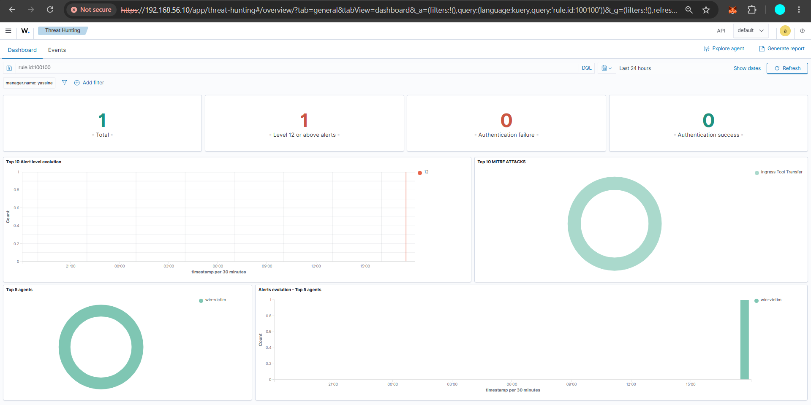

# Open-Source SOC Lab (Wazuh, Sysmon, Suricata)

A small SOC built entirely from free tools on one laptop. I attacked my own lab with known techniques, measured what the default setup detected, wrote custom rules for the gaps, and tested again.

**Result: 9 of 16 techniques detected out of the box, 13 of 16 after my 4 custom rules.**

> This is a lab project, not production experience. The Windows VM is a single test machine with Defender relaxed on purpose so the attack tests can run.

## What's in the lab

| Machine | Role | Tools |
|---|---|---|
| `wazuh-srv` (Ubuntu) | SIEM / XDR and network IDS | Wazuh (manager, indexer, dashboard), Suricata with ET Open rules |
| `win-victim` (Windows 10 Pro) | Monitored endpoint | Sysmon (SwiftOnSecurity config), Wazuh agent, Atomic Red Team |

Both VMs run on VMware on a laptop (16 GB RAM). Each has two network adapters: NAT for internet, and a host-only network (`192.168.56.0/24`) for the lab traffic.

```
win-victim (192.168.56.20)  --Sysmon + Wazuh agent-->  wazuh-srv (192.168.56.10)
                                                         |-- Wazuh manager: decoders, rules, alerts
                                                         |-- Suricata: network alerts (eve.json)
                                                         |-- Indexer + Dashboard
```

## Log sources

| Host | Source | Collected by | What it gives |
|---|---|---|---|
| win-victim | Sysmon (`Microsoft-Windows-Sysmon/Operational`) | Wazuh agent | Process creation with full command line, registry, network |
| win-victim | Windows Security log | Wazuh agent (default) | Logons, account changes |
| win-victim | PowerShell (`Microsoft-Windows-PowerShell/Operational`) | Wazuh agent | Script block logging |
| wazuh-srv | Suricata `eve.json` | Wazuh manager | Network alerts |

## Method

1. Ran one Atomic Red Team test for each of 16 ATT&CK techniques with a PowerShell script (`scripts/run-all.ps1`), which also records the start and end time of each test.
2. A Python script (`scripts/check.py`) reads the Wazuh alerts for each time window and prints the alarm names.
3. A technique counts as **detected** if an alert about the real behaviour fired. Two generic alerts that appeared in every test (a cmd shell started by PowerShell) came from the test harness itself, so I ignored them.
4. For each miss, I looked at the Sysmon event, wrote a rule, restarted the manager, repeated the test, and checked the alert.

## Results

| Technique | What the test did | Out of the box | After my rules |
|---|---|---|---|
| T1059.001 | PowerShell (the test ran Invoke-Mimikatz) | Detected (high) | Detected |
| T1059.003 | Batch script via cmd | Detected (high) | Detected |
| T1547.001 | Registry Run key | Detected (high) | Detected |
| T1136.001 | Create a local user | Detected (high) | Detected |
| T1543.003 | Modify a service | Detected (low) | Detected |
| T1033 | User discovery | Detected (low) | Detected |
| T1087.001 | Account discovery | Detected (low) | Detected |
| T1016 | Network configuration discovery | Detected (low) | Detected |
| T1018 | Remote system discovery | Detected (low) | Detected |
| T1105 | File download with `certutil` | Missed | **Fixed, rule 100100** |
| T1218.005 | `mshta` running a script | Missed | **Fixed, rule 100101** |
| T1218.011 | `rundll32` running a script | Missed | **Fixed, rule 100102** |
| T1053.005 | Scheduled task with `schtasks` | Missed | **Fixed, rule 100103** |
| T1082 | `systeminfo` | Missed | Missed (on purpose) |
| T1083 | `dir` | Missed | Missed (on purpose) |
| T1057 | `tasklist` | Missed | Missed (on purpose) |

"Low" means the alert is level 3, the kind that would sit unread in a busy SOC. Raising those levels is future work.

## Custom rules

All in `rules/local_rules.xml`. Each one matches a Sysmon process-creation event by program name and a keyword in the command line.

| Rule ID | Level | Looks for | ATT&CK |
|---|---|---|---|
| 100100 | 12 | `certutil.exe` with `urlcache` or `verifyctl` | T1105 |
| 100101 | 12 | `mshta.exe` with `javascript:`, `vbscript:` or a URL | T1218.005 |
| 100102 | 12 | `rundll32.exe` with `javascript:`, `vbscript:` or `RunHTMLApplication` | T1218.011 |
| 100103 | 8 | `schtasks.exe` with `/create` or `-create` | T1053.005 |

I gave the scheduled-task rule a lower level (8) than the others because legitimate software also creates scheduled tasks.

## Decisions and limitations

- **The 3 discovery techniques (T1082, T1083, T1057) are left as logged-only.** `systeminfo`, `dir` and `tasklist` are run by normal users and admins all the time, so a rule per command would drown real alerts in false alarms.
- I tried a correlation rule (alert when several discovery commands happen within 5 minutes). It rang, but I could not show that it stays quiet for normal use, so I took it out. A backup is in `rules/local_rules_with_discovery_backup.xml`.
- `dir` is built into the command prompt and starts no process of its own, so Sysmon process events cannot see it.
- **Not validated on variants.** I wrote each rule after seeing the exact test that was missed. A different certutil option or a renamed binary may get past them. I started testing variants, see the section below.
- One test per technique, in a single lab with one Windows machine.

## Repo layout

```
rules/       custom Wazuh rules
scripts/     run-all.ps1 (attack runner), check.py (result checker)
results/     baseline-results.txt (raw checker output before my rules; "CHECK NAMES" means I reviewed the alarms by hand), results-final.csv (test timings)
docs/        screenshots
```

## Next

- Test more variants (other download tools, renamed binaries)
- Local LLM (Ollama) to explain and triage alerts, and test it against prompt injection through log fields
- Add Active Directory and a Kali machine for network attacks

## Screenshot




## Variant testing

To check that the rules don't only match the exact tests I wrote them for, I ran slightly different versions of some attacks. The original attacks served as a control: they still fired their rules the same day, so the misses are real and not a broken pipeline.

| Variant | Result |
|---|---|
| `schtasks -create` (dash instead of slash) | **Missed** by rule 100103, which only looked for `/create`. Fixed by accepting `/` or `-`, retested: caught. |
| `certutil.exe` copied to another name | Could not be tested: the renamed copy would not run in this lab. |
| PowerShell download instead of certutil | Not tested yet. Likely to be missed; a rule would be noisy because PowerShell downloads files in normal use. |
